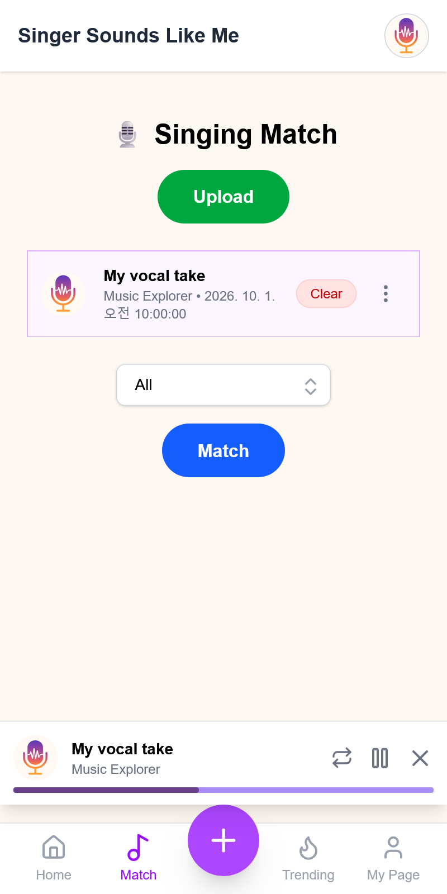
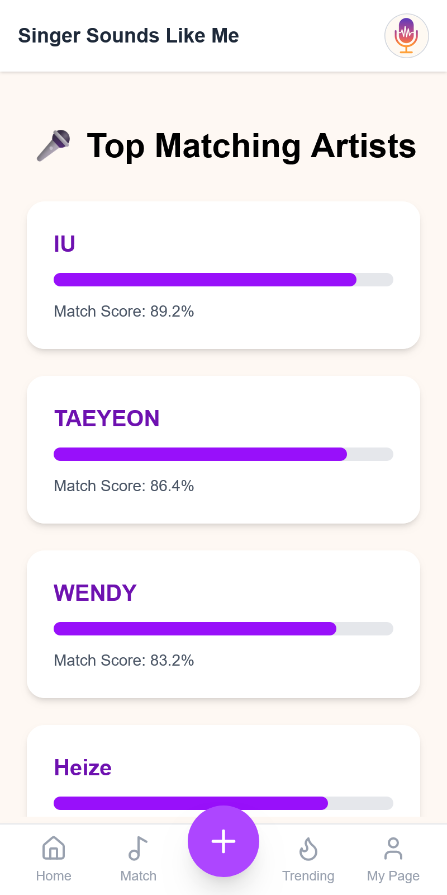
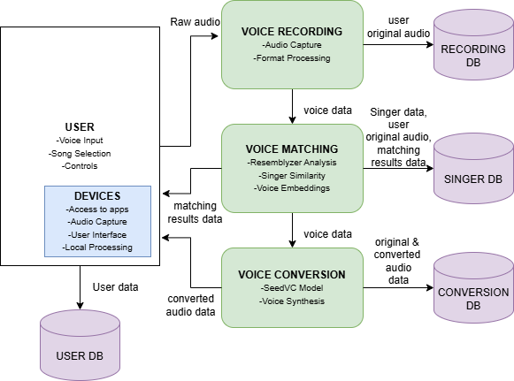
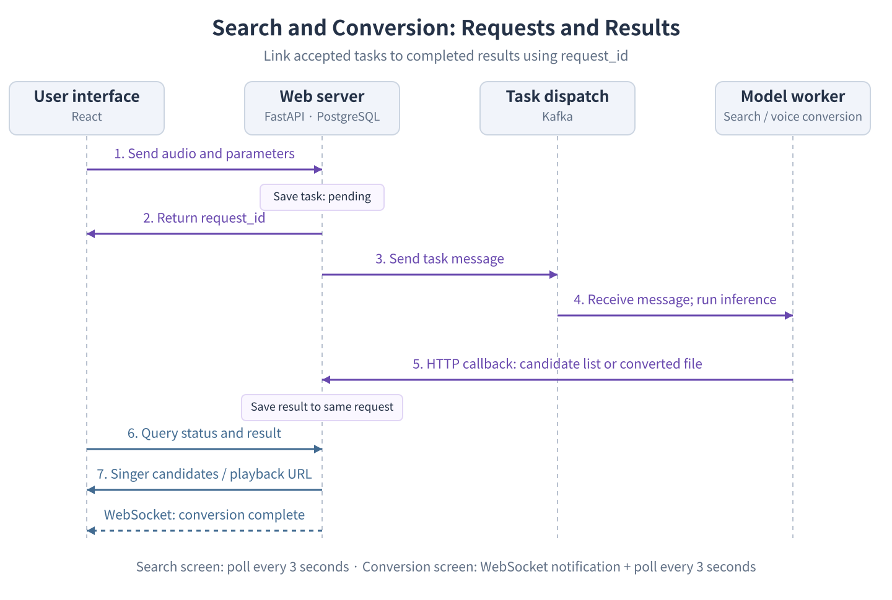

# 🎙️ Singer Sounds Like Me

### Find singers who sound like you, then try a voice of your choice

Singer Sounds Like Me is a **web service that finds singers with voices similar to yours and converts your audio into a selected singer's voice**. Upload or record a clip, explore matching singers, and choose a target voice to hear how the same recording changes.

The project focuses on **searching by vocal characteristics**. It builds a searchable database from singers' recordings and connects voice models, APIs, and a web interface so users can move from similarity search to voice conversion in one workflow.

**Upload or record → Find matching singers → Choose a target voice → Play the result**

[Features](#features) · [Architecture](#architecture) · [Audio Data Pipeline](#audio-data-pipeline) · [Design Decisions and Implementation](#design-decisions-and-implementation) · [Getting Started](#getting-started)

## Features

<table>
  <tr>
    <th>Voice input and search</th>
    <th>Matching singers</th>
  </tr>
  <tr>
    <td align="center"><a href="assets/img/voice-input.png"></a></td>
    <td align="center"><a href="assets/img/artist-results.png"></a></td>
  </tr>
</table>

### 1. Upload a clip or record your voice

The input dialog supports both file uploads and browser recording. A completed recording becomes an audio file in the upload list, and users can preview it before submitting. Uploaded files remain available in each user's list for later searches and conversions.

- Select a recording and search across all, male, or female singers.
- The interface shows the upload list, selected recording, and search progress separately.

[Upload and recording dialog](services/frontend/src/components/widgets/UploadModal.jsx) · [Browser recorder](services/frontend/src/components/common/VoiceRecorder.jsx) · [Upload API](services/backend/routers/uploads.py)

### 2. Explore singers with similar voices

Pressing Match compares the selected recording with the singer database. Results display each singer's name and matching score.

The search screen shows **up to five distinct singers**. Users can review these candidates, run another search, or move to voice conversion. Each matching score represents the cosine similarity between the input voice and a representative vector.

[Search screen](services/frontend/src/pages/MatchingPage.jsx) · [Results screen](services/frontend/src/pages/ResultPage.jsx) · [Similarity search](services/voice-embedding/voice_embedding/search.py#L51-L85)

### 3. Convert to a selected singer's voice and play the result

The conversion screen lets users **choose both the input recording and the target singer**.

Once a conversion request is accepted, the interface displays its progress. When inference finishes, the service returns the output audio URL for playback through the Play button and shared audio player. The singer vocals prepared for search also serve as reference audio for voice conversion.

[Voice selection, conversion, and playback](services/frontend/src/pages/ConversionPage.jsx) · [Audio player](services/frontend/src/components/common/Player.jsx) · [Conversion API](services/backend/routers/convert.py)

## Architecture

### From voice input to search and conversion

<p align="center">
  <a href="assets/img/data-flow.png"></a>
</p>

The system separates web request handling from voice model execution. The web backend manages uploaded files and job states, while model services return search or conversion results. PostgreSQL stores user and request information; NPZ data and FAISS indexes support voice-vector search.

| Component | Responsibility | Main code |
| --- | --- | --- |
| React frontend | Voice input, search results, singer selection, job status, and playback controls | [pages](services/frontend/src/pages) |
| FastAPI backend | Authenticated requests, file and job records, and result retrieval | [routers](services/backend/routers) |
| Voice embedding service | Singer database construction, input voice embeddings, and similarity search | [voice-embedding](services/voice-embedding) |
| Voice conversion service | Seed-VC inference using the selected singer's reference vocals | [voice-converter](services/voice-converter) |
| Vocal separation service | Separation of vocals and accompaniment in singers' recordings | [vocal-separation](services/vocal-separation) |
| Kafka · PostgreSQL · Nginx | Model job delivery, request state storage, and web and audio file serving | [Compose configuration](docker-compose-local.yml) |

### Request handling and result delivery

<p align="center">
  <a href="assets/img/request-flow.png"></a>
</p>

1. **Accept:** The backend receives the audio path and search filters or target singer, creates a request ID, and saves the job with a `pending` status.
2. **Dispatch:** A Kafka message carries the request details and ID to the model service. The web interface checks progress by ID rather than keeping an HTTP request open throughout inference.
3. **Process:** The search service returns singer candidates, and the conversion service returns the generated audio file, through HTTP callbacks to the backend.
4. **Update:** The backend stores the result against the same request ID. The search screen polls for results; the conversion screen combines WebSocket notifications with polling to retrieve the playable output.

[Search request handling](services/backend/routers/match.py#L41-L99) · [Search result storage](services/backend/routers/match.py#L164-L187) · [Conversion result storage and notifications](services/backend/routers/convert.py#L114-L138)

## Audio Data Pipeline

Singer recordings are processed in advance: vocals are separated, representative vectors are computed, and the results are stored in the search database. At query time, the uploaded user recording is embedded directly and compared with these prepared vectors.

### Preparing the singer database

| Stage | Processing | Output |
| --- | --- | --- |
| Audio and metadata preparation | Link singers, tracks, and file paths | Singer and track CSV files, `metadata.jsonl` |
| Vocal separation | Extract vocals with Mel-Band Roformer | Separated vocal files |
| Segment extraction | Extract non-silent segments from the vocals | By default, 3–5-second segments, up to 10 per track |
| Voice feature extraction | Resample segments to 16 kHz and pass them to Resemblyzer | A voice embedding for each segment |
| Representative vector construction | Group and summarize segments by track, then by singer | Segment-, track-, and artist-level NPZ data |
| Search index construction | Normalize vectors and load them into FAISS | Indexes split by category and gender |

[Vocal separation](services/vocal-separation/vocal_separation/core/process.py) · [Segment extraction](scripts/sampling_audio.py) · [Metadata assembly](scripts/merge_metadata.py) · [Embeddings and representative vectors](services/voice-embedding/voice_embedding/build_db.py)

### Searching and converting user recordings

- **Search:** Read the uploaded recording, resample it to 16 kHz, and extract an embedding with the same encoder used for the singer database. Query the index for the selected filters and deduplicate results by singer.
- **Conversion:** Pass the user's recording and the selected singer's reference vocals to Seed-VC. Upload the output file to the backend and expose it through a playback URL.

## Design Decisions and Implementation

### 1. Compare vocal characteristics rather than whole songs

**Problem:** A song contains accompaniment, lyrics, and melody alongside the singer's vocal timbre. Voice-based singer search first needs a clear choice of which characteristics to compare.

**Approach:** Separate vocals from singer recordings and use Resemblyzer embeddings, trained to represent speaker characteristics, as the basis for search. Instead of training a classifier that predicts singer names, compare user recordings and singer vocals in the same vector space. Adding a singer then follows the same process of extracting features and updating the index.

- Both database construction and query processing resample audio to 16 kHz and use `VoiceEncoder`.
- The search service loads separate segment-, track-, and artist-level databases. The web search interface uses the artist-level index.

[Database feature extraction](services/voice-embedding/voice_embedding/build_db.py#L59-L76) · [Query processing and search](services/voice-embedding/voice_embedding/search.py#L51-L85)

### 2. Represent a singer with more than a single average

**Problem:** A singer's pitch range, vocal intensity, and timbre vary across tracks and segments. Averaging every segment into one vector can lose that variation, while retaining every segment increases the number of vectors to compare for each singer.

**Approach:** Build representative vectors in two stages, grouping segment embeddings by track and then by singer. K-means summarizes the segment features into a limited set of cluster centers; FAISS searches for similarities between those representative vectors and the input voice.

| Aggregation stage | Default behavior |
| --- | --- |
| Segment vectors within a track | Keep all vectors when there are 10 or fewer; otherwise use 10 K-means centers |
| Track vectors collected for a singer | Use one mean vector when there are fewer than 10; otherwise use 10 K-means centers |

With the default sampling settings, segment vectors are retained at the track level and summarized into representative vectors at the singer level.

At search time, normalized vectors are compared using a FAISS inner-product index. If several representative vectors from the same singer appear among the nearest results, only the highest-scoring result is kept. This lets a singer match through a relevant vocal characteristic without occupying multiple positions in the candidate list.

[Track-level vectors](services/voice-embedding/voice_embedding/build_db.py#L98-L114) · [Artist-level vectors](services/voice-embedding/voice_embedding/build_db.py#L132-L164) · [Indexing and deduplication](services/voice-embedding/voice_embedding/search.py)

### 3. Keep search candidates separate from the target voice

**Problem:** The singer closest to the input voice may not be the voice the user wants to try. Training a separate model for each singer would also require additional training and model management whenever a new singer is added.

**Approach:** Use search to suggest candidates, while letting users select the target singer directly for conversion. Seed-VC conditions the target timbre on reference audio, so choosing a singer can map directly to choosing that singer's vocal file.

- The backend creates a conversion request from the input recording and target singer name, converting the input file to WAV when needed.
- The conversion worker finds a track by the selected singer in the metadata and supplies its separated vocals as reference audio.
- The generated WAV file is returned to the backend, and the interface uses the completed request's playback URL.

[Target singer selection](services/frontend/src/pages/ConversionPage.jsx) · [Reference vocal selection](services/voice-converter/main.py#L45-L64) · [Seed-VC inference](services/voice-converter/main.py#L66-L92)

### 4. Run model inference separately and reconnect results to requests

**Problem:** Voice search and conversion can take longer than ordinary web requests, and each model has its own dependencies and GPU requirements. Users need to submit a job and retrieve its result once processing finishes.

**Approach:** Run each model service in its own Docker container and dispatch jobs through Kafka. The backend assigns a UUID to every request, stores its inputs and status, and attaches the model's result to the request with the same ID. This ID tracks a single job across the web interface, backend, and model worker.

PostgreSQL stores request states and results or output file paths. Audio playback uses files served by Nginx.

[Search worker](services/voice-embedding/main.py#L110-L141) · [Conversion worker](services/voice-converter/main.py#L95-L155) · [Request and status tables](services/backend/init_schema.py) · [WebSocket connection management](services/backend/main.py)

## Tech Stack and Repository Layout

| Area | Technologies | Role in the project |
| --- | --- | --- |
| Interface | React, Redux Toolkit, Tailwind CSS, Vite | Voice selection, request status, result lists, and audio playback |
| API and data | FastAPI, PostgreSQL | Users, uploads, search and conversion requests, and results |
| Voice processing | Mel-Band Roformer, Resemblyzer, scikit-learn, FAISS, Seed-VC | Vocal separation, embeddings, representative vectors, search, and conversion |
| Runtime and communication | Docker Compose, Kafka, Nginx | Service isolation, job delivery, and web and static audio serving |

```text
services/
  frontend/          # User interface, state management, and audio player
  backend/           # Authentication, upload/search/conversion APIs, and DB initialization
  vocal-separation/  # Vocal separation for singer recordings
  voice-embedding/   # Embedding database construction and similarity search
  voice-converter/   # Seed-VC worker and result delivery
  nginx/             # Frontend build, API routing, and audio file serving
scripts/             # Audio and metadata preparation, segment extraction
datasets/            # Singer/track information and runtime data
assets/img/          # README screenshots and diagrams
docs/                # Setup and implementation notes
```

To explore the code, follow the [search screen](services/frontend/src/pages/MatchingPage.jsx) → [search API](services/backend/routers/match.py) → [search worker](services/voice-embedding/main.py) → [search implementation](services/voice-embedding/voice_embedding/search.py). For conversion, follow the [conversion screen](services/frontend/src/pages/ConversionPage.jsx) → [conversion API](services/backend/routers/convert.py) → [conversion worker](services/voice-converter/main.py).

## Getting Started

### 1. Clone the repository

```bash
git clone https://github.com/hemaher0/GIST-CS-Project-SingerSoundsLikeMe.git
cd GIST-CS-Project-SingerSoundsLikeMe
```

### 2. Prepare the environment and data

- **Runtime:** Set up Docker Compose and NVIDIA GPU container support. The search service uses CUDA and GPU FAISS.
- **Models and audio:** Prepare `MelBandRoformer.ckpt` for vocal separation, the Seed-VC model files, and the singer recordings to use.
- **Search database:** Prepare the singer and track CSV files and `datasets/metadata.jsonl`, then run vocal separation, segment extraction, and embedding generation to produce the search NPZ files.
- **Paths:** Place model files, audio data, and the search database at the paths expected by each service's environment variables and volume mounts. See the [running guide](docs/RUNNING.md) for filenames and database output and lookup paths.

### 3. Start the services

Once the models, data, and paths are ready, run this command from the repository root:

```bash
docker compose -f docker-compose-local.yml up --build
```

See the [technical notes](docs/TECHNICAL_NOTES.md) for details on candidate selection, reference vocals, and job processing.

Nginx serves the web interface on host port 80. Sign in, upload or record a clip, and search for matching singers. Choose a target singer on the conversion screen, then press Play when conversion finishes.
